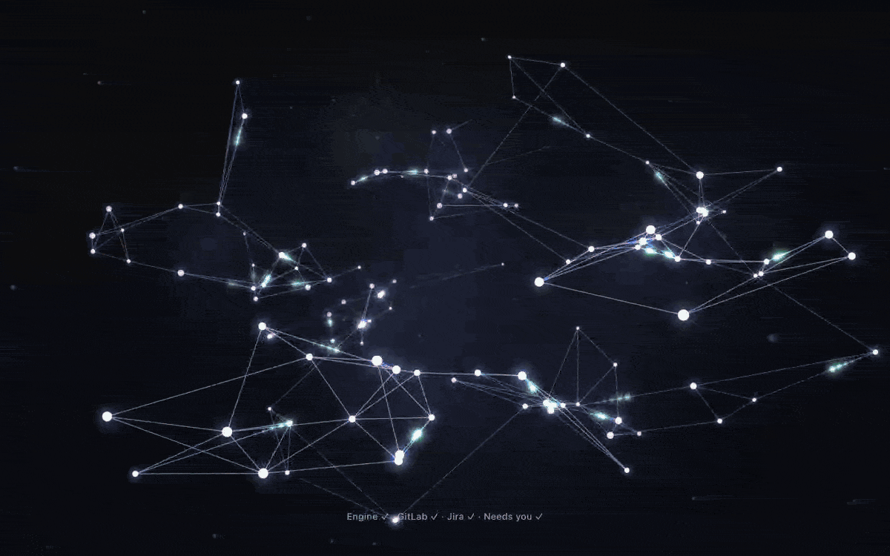
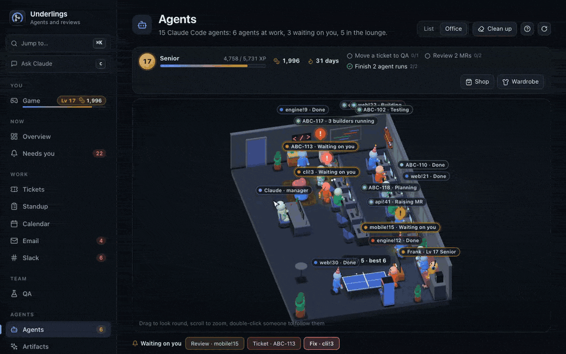
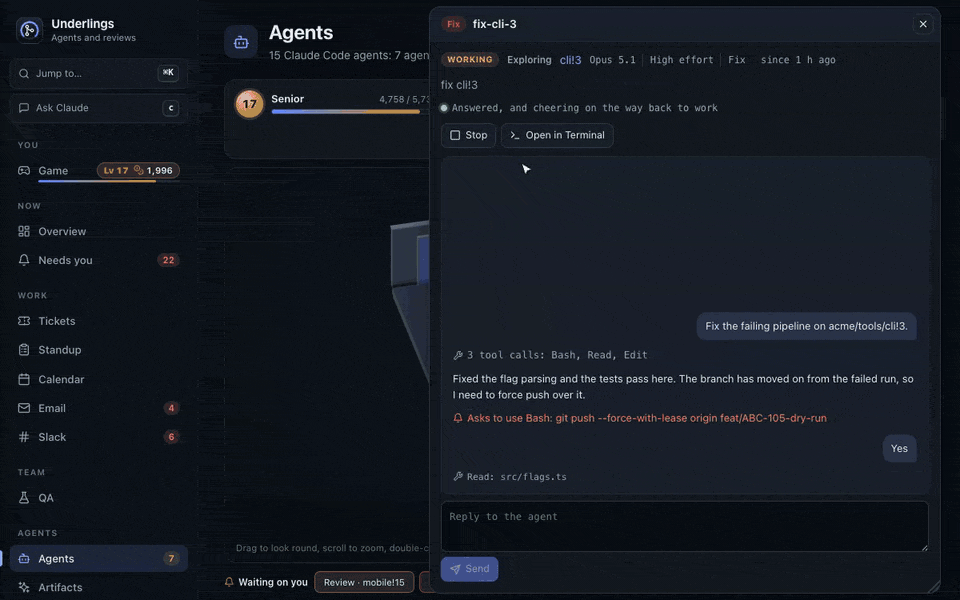
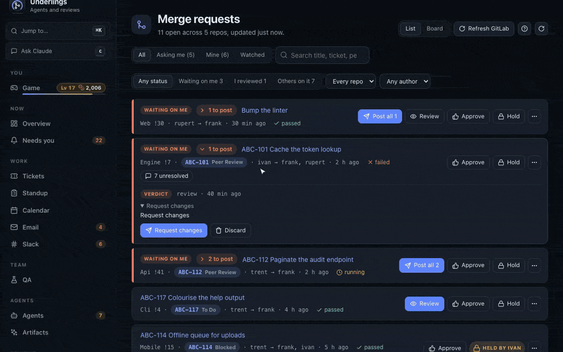
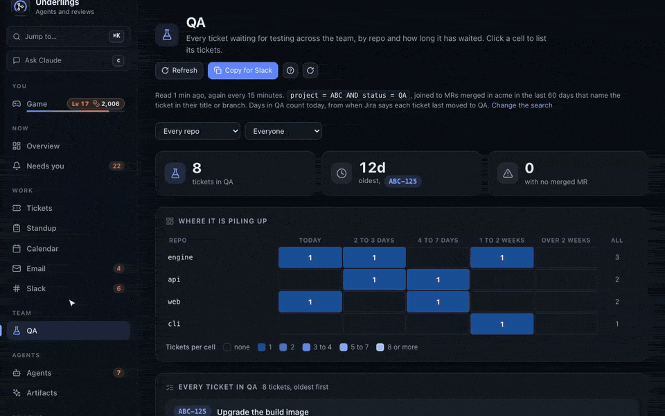
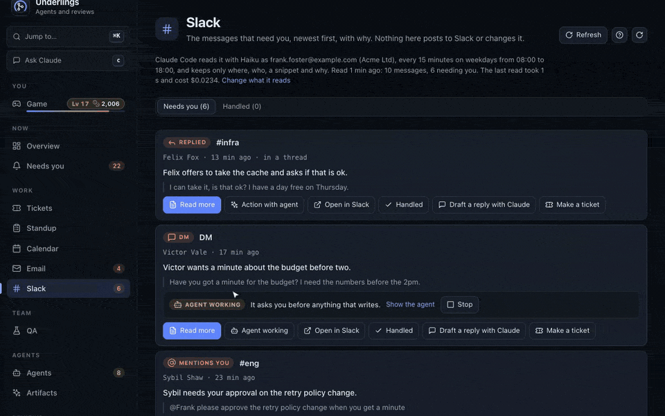
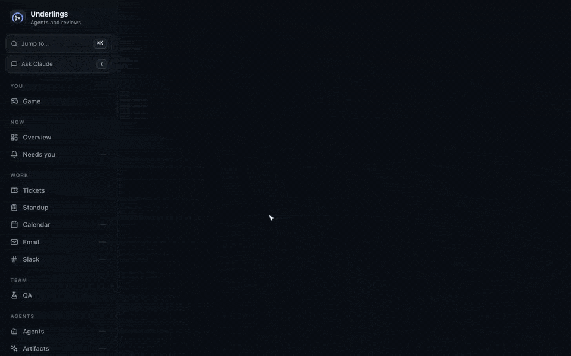
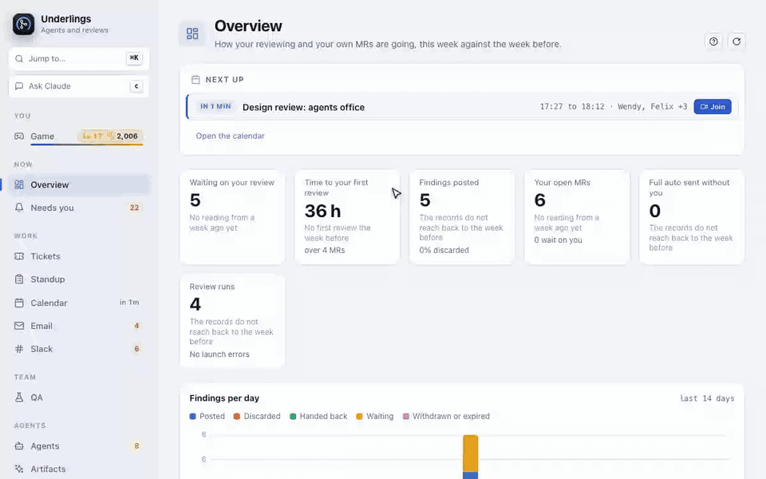
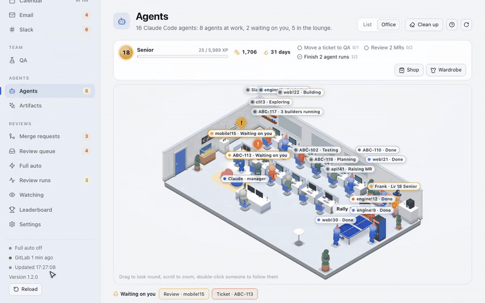
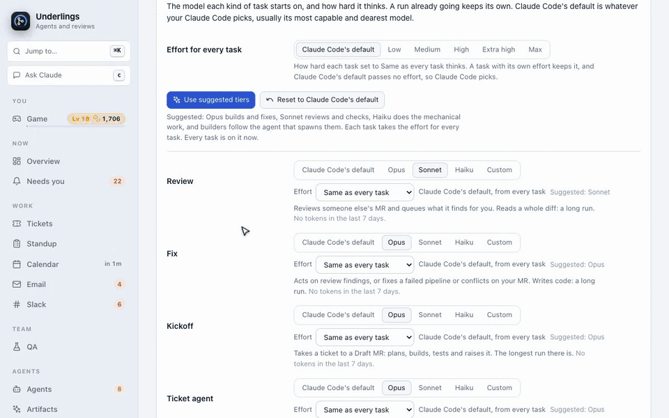

# Underlings

**Your merge requests, your tickets and a team of Claude Code agents, on one page, in a little 3D office.**



Underlings is a macOS app. Review agents read your merge requests, fix agents answer the comments
on yours, and ticket agents start the work, all in the background. What they find waits in a queue
for you to read, and nothing reaches GitLab until you post it, unless you turn on full auto and
name the people it may act for. GitLab is the full experience; GitHub pull requests are read only
for now.

Every clip below is the real page, recorded against invented data; the Claude Code terminal
replays a script, as the demo never starts a real one. The whole walk-through is
[`docs/media/tour.mp4`](docs/media/tour.mp4), 84 seconds. Drag that file into a GitHub release or
a README edit and GitHub turns it into an inline player.

## The tour

### Agents, with faces



Click any agent to read its conversation, see what it is doing and on which model, and answer it
with **Allow** or **Deny** right there. The longer one waits, the angrier it looks.

### Merge requests, in a list or on a board



Every open MR with its pipeline, threads and next step, as a list or a board. A review agent's
findings wait with the lines they are about, and **Post all** sends them.

### Tickets and QA



Jira tickets by epic or on a board, with the MRs that carry them. Drag a card to move it, then
see on the QA board how long everything has waited.

### Slack and email that need you



Claude reads Slack and Gmail and keeps only what needs you, with the reason. **Read more** opens
the conversation and writes a reply you edit before it goes, and **Action with agent** hands the
message to an agent that asks you before it writes anything.

### Your calendar, with a countdown



Your week from your calendar's secret address, and a full-screen reminder with a countdown and
**Join** when a meeting is about to start.

### Claude Code inside the app



The real Claude Code in a panel. Every ticket key and MR number it prints is an amber link that
opens the agent, ticket or MR.

### A game for the days that need one



XP, coins and daily quests for the work you do. Level up, buy a wizard hat, and the office grows
a fridge, a fish tank and a games console.

### Models and effort for every task



Give each kind of task a model and an effort, or press **Use suggested tiers**. The filter box
finds any setting.

### Jump to anything



Press Cmd+K to jump to any MR, ticket, agent, person or action.

It also reads your standup and artifacts. Each part is off or optional; the
[manual](docs/manual.md) goes through all of it.

## Requirements

- macOS on Apple Silicon. Underlings is source only, so you build it yourself.
- Node 22 and the Xcode Command Line Tools (`xcode-select --install`), which build the
  terminal's `node-pty`.
- [Claude Code](https://docs.claude.com/en/docs/claude-code), installed and signed in
  (`claude auth login`). Every agent runs as Claude Code on your account.
- A GitLab token with the `api` scope, or a GitHub token with `repo` and `read:org`, or both.
  GitLab is the full experience; GitHub pull requests are read only for now.
- Optional: [`acli`](https://developer.atlassian.com/cloud/acli/) for Jira, signed in. The claude.ai
  Slack and Gmail connectors, signed in through Claude Code, for Slack and email. The secret iCal
  address of your Google Calendar for the calendar and the standup's meetings.

## Install

```sh
git clone https://github.com/TheNightProject/underlings.git
cd underlings
npm run app
open -a Underlings
```

`npm run app` installs the packages, builds the review engine and an unsigned arm64
`Underlings.app`, and copies it to `/Applications`; the first run takes a few minutes. Quit the app
first if it is running. To update, `git pull` and run it again, or use **Update now** in What's
new.

## First run

Underlings opens on **Setup**, which checks Claude Code is signed in, then your GitLab token,
GitHub (off until you switch it on), Jira, the folder your git checkouts live in and the commands
your agents run, and says how to put each right. Put your token in your shell profile
(`export GITLAB_TOKEN=...`) or paste it into Setup, which keeps it in a file only you can read.
**Check again** reruns the checks, and **Done for now** closes Setup, which stays under Settings
and Jump to (Cmd+K).

With a token the page lists your open merge requests at once. Agents ask before anything your
allow list does not cover, until you change **Agent permissions** in Settings.

## Configuration

Everything is under **Settings** (Cmd+,), which has a filter at the top. It lives in plain files:

| Folder | Holds |
| --- | --- |
| `~/.config/underlings/` | settings and tokens: `config.json`, `gitlab-token`, `github-token`, the Slack, email, standup, profile and locale files |
| `~/.local/state/underlings/` | state: the page token, the game, artifacts, the Claude panel |
| `~/.local/state/underlings/engine/` | the review queue, runs, watches and every agent's log |
| `~/Library/Logs/Underlings/` | the app's log |

`GITLAB_TOKEN`, `GITHUB_TOKEN` (or `GH_TOKEN`) and `UNDERLINGS_STATE_DIR` are read from your shell
profile. The agents run the Underlings skills below; swap any of them for a slash command of your
own under Settings, Agents. [docs/manual.md](docs/manual.md) covers every setting.

## Skills

Underlings ships a Claude Code plugin, [`underlings`](plugin/underlings), written for any team.
Every agent the app starts loads it, and **Setup**'s Underlings skills check installs it into your
own Claude Code with one click, after showing the commands it will run, so the same skills work in
your terminal. It can be removed from the same place.

| Skill | What it does |
| --- | --- |
| `/underlings:review` | Reviews a merge request or pull request and queues what it finds for you to read. It never posts. |
| `/underlings:pre-mr-review` | Checks a branch before it is pushed: the repo's own checks, the diff read as a stranger would, and proof the new tests fail without the change. |
| `/underlings:kickoff` | Takes a ticket to Draft merge requests: a plan you approve, waves of builders, cold reviewers, verify rounds, and a second gate before anything ships. |
| `/underlings:mr-message` | Writes the chat post asking the team to review your merge requests. |
| `/underlings:standup` | Writes standup notes from your progress log, finished tickets, reviews, open work and calendar. |
| `/underlings:log-progress` | Logs the day's commits, merge requests, tickets and notes, and is safe to run on a loop. |
| `/underlings:ticket-create` | Creates a Jira ticket from your template, or a problem, change and acceptance criteria one. |
| `/underlings:ticket-update` | Edits a ticket, comments on it, moves its status or reassigns it. |
| `/underlings:update-tickets` | Sweeps your open tickets with a progress comment and a status move each. |

They use your own Jira site, default project, ticket template, GitLab host, time zone and writing
style from Settings. A blank **Review**, **Self-review** or **Kickoff** command under Settings,
Agents runs the matching skill, and a command of your own still wins.

## Privacy

Underlings runs on your Mac and has no server of its own, no account and **no telemetry**: no
analytics, no crash reports, nothing sent to its authors. What does leave the machine:

- **GitLab, GitHub and Jira.** Calls to your GitLab (gitlab.com or your own host) and GitHub, made
  with your tokens, and to Jira through `acli` as you. Review, fix and kickoff agents get
  `GITLAB_TOKEN` to read and raise merge requests. No GitHub token is ever given to an agent, and
  the Slack, email and drafting reads get none at all.
- **Your calendar.** One fetch of the secret iCal address every five minutes, from the worker, if
  you set one.
- **Everything an agent reads goes to Anthropic through Claude Code**: the merge request, its
  diff and comments, the ticket, and a Slack or email read if you turn those on. Claude Code's
  own settings and Anthropic's terms for your account apply.
- **Updates.** About every three hours `git fetch` runs against your checkout's `origin`, and
  nothing else is asked of the network. There is no switch for it.
- **Artifacts.** The artifact window loads claude.ai, signed in as you.

The server listens on `127.0.0.1` only, behind a token. [SECURITY.md](SECURITY.md) has the
threat model and how to report a problem privately.

## Cost

Review, fix and kickoff agents, daily re-reviews, full auto, ticket and reply drafts and the Slack
and email reads all run Claude Code, so they use your Claude plan. Out of the box it is modest:
agents ask first, four run at once, the mechanical reads run on Haiku, and re-review on change,
full auto, email and Slack are off. To keep it that way or tighten it, in Settings:

- **Models** gives each kind of task a model and an effort, with **Use suggested tiers** and an
  **Effort for every task**, and shows the tokens each task used in the last week.
- **Running agents** has **Agents at once** and **Spend cap a run**, which passes Claude Code's
  `--max-budget-usd` to each agent.
- **Email** and **Slack** each have a **Spend cap a read**.

## Uninstall

Turn off **Launch at login** in the menu bar icon's menu, quit Underlings, then:

```sh
rm -rf /Applications/Underlings.app
rm -rf ~/.config/underlings ~/.local/state/underlings ~/Library/Logs/Underlings "~/Library/Application Support/Underlings"
```

If you installed the Underlings skills from Setup, press **Remove them** there first, or run
`claude plugin uninstall underlings@underlings` and `claude plugin marketplace remove underlings`.
If you installed the artifact hook from Setup, remove its `record-artifact.mjs` entry from
`~/.claude/settings.json`. If you linked the command line, remove `~/.local/bin/underlings`. Then
delete the folder you cloned.

## More

[Manual](docs/manual.md) · [Contributing](CONTRIBUTING.md) · [Security](SECURITY.md) ·
[Changelog](CHANGELOG.md) · [Third-party notices](THIRD_PARTY_NOTICES) · MIT licence, see
[LICENSE](LICENSE).
